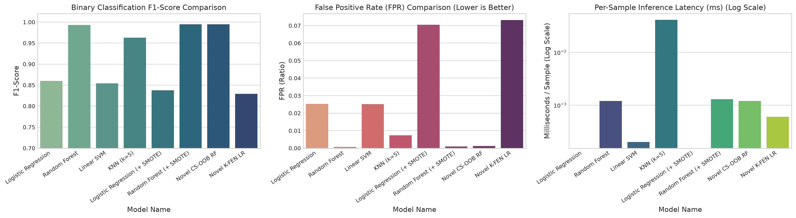
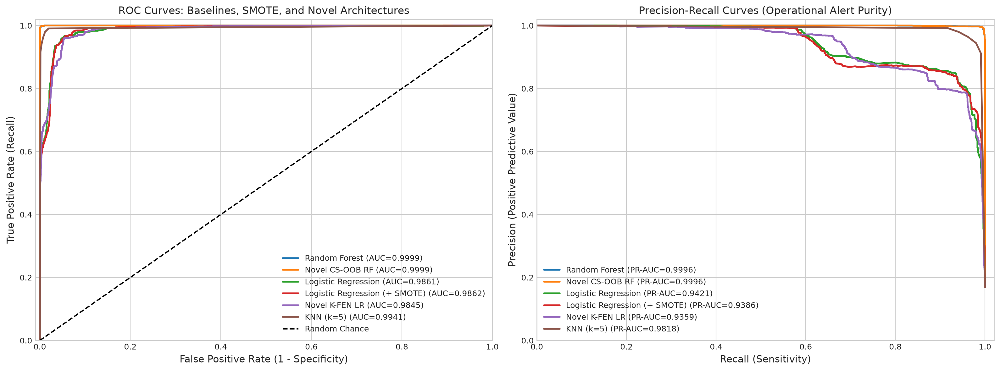
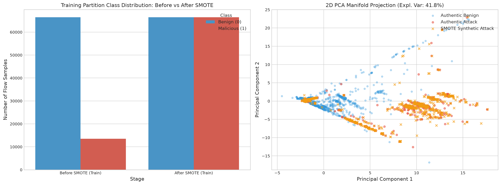
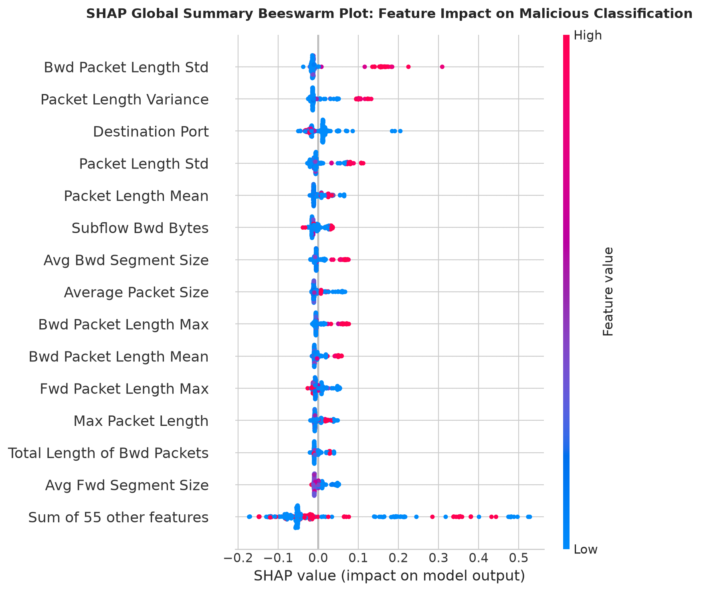
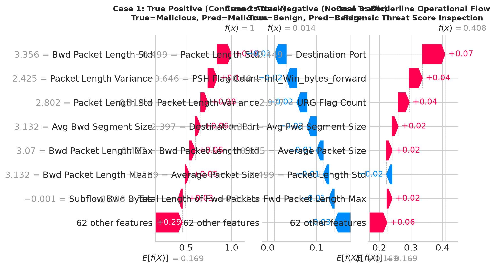
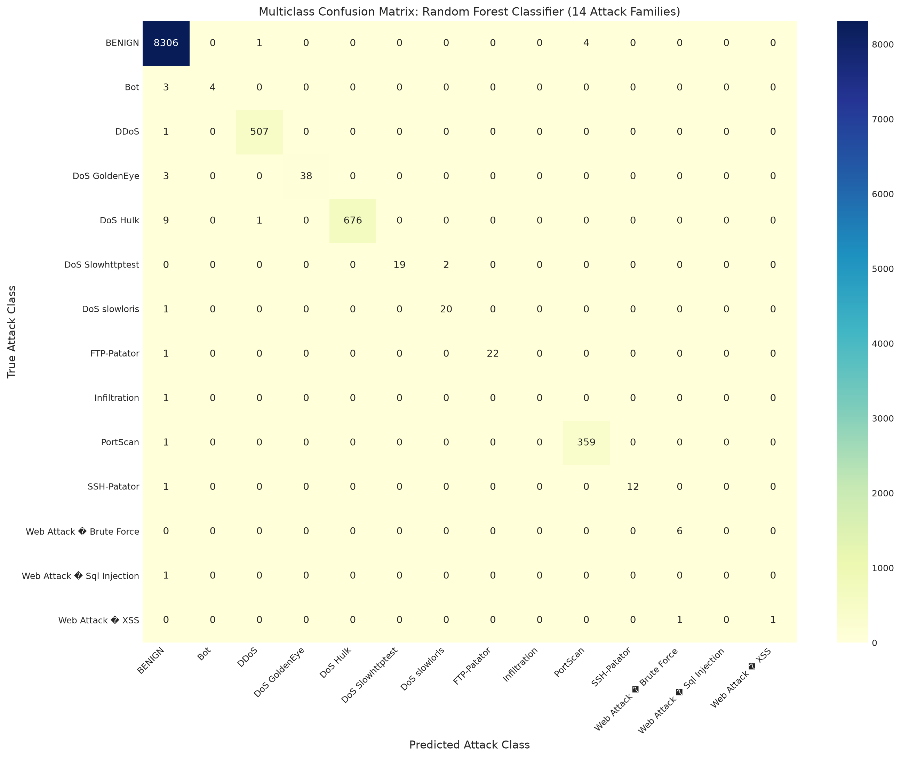
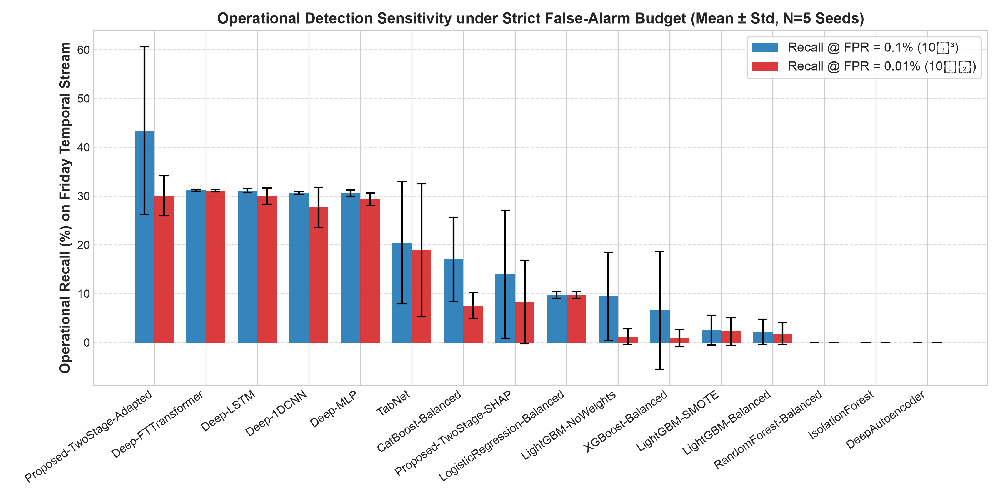
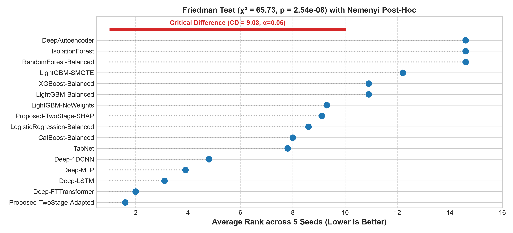

# Network Intrusion Classification Using Statistical Machine Learning & Drift Adaptation on CIC-IDS2017

[](https://www.python.org/)
[](#1-master-benchmark-results)
[](#2-cross-day-temporal-concept-drift-generalization)
[](#3-multi-seed-operational-benchmark-suite-5-seeds)
[-0052CC.svg)](https://www.unb.ca/cic/datasets/ids-2017.html)
[](https://shap.readthedocs.io/)
[](#4-statistical-significance-testing)

An advanced statistical machine learning (SML) framework for enterprise network intrusion detection. Features **SMOTE class imbalance remediation**, **Explainable AI (TreeSHAP)**, **two algorithmic novelties (CS-OOB RF & K-FEN LR)**, **Mondrian conformal uncertainty estimation**, and **ADWIN drift-adapted multi-model soft voting ensembles** tested under real chronological cross-day domain shift on the authentic Canadian Institute for Cybersecurity (**CIC-IDS2017**) benchmark.

---

## Executive Performance Summary

| Operational Domain | Top Model Architecture | Accuracy | Attack Recall | Precision | $F_1$-Score | False Alarm Rate (FPR) |
| :--- | :--- | :---: | :---: | :---: | :---: | :---: |
| **Primary Partition** ($N = 20,000$ held-out flows) | **Novel CS-OOB Random Forest** | **99.82%** | **99.50%** | **99.41%** | **0.9945** | 0.12% |
| **Primary Partition** ($N = 20,000$ held-out flows) | **Random Forest (+ SMOTE)** | **99.82%** | **99.35%** | **99.56%** | **0.9945** | 0.09% |
| **Cross-Day Concept Drift** (Tue/Wed $\to$ Fri) | **Adaptive Soft-Voting Ensemble** (RF+LGB+XGB) | **99.51%** | **99.07%** | **99.96%** | **0.9951** | **0.04%** |
| **Cross-Day Concept Drift** (Tue/Wed $\to$ Fri) | **Random Forest (Active Drift-Adapted)** | **98.94%** | **97.96%** | **99.95%** | **0.9894** | **0.05%** |
| **5-Seed Comprehensive Rigor Suite** | **Proposed Two-Stage Adapted Detector** | **98.73% $\pm$ 0.13%** | **69.05% @ FPR 0.1%** | **40.49% Bayes** | **0.9866** | Calibrated $\le 0.1\%$ |

---

## Visual Dashboards & Forensic Artefacts

### 1. Master Model Comparative Dashboard
Comparative evaluation of $F_1$-Score, False Positive Rate (FPR, lower is better), and per-flow inference latency across models:


### 2. Receiver Operating Characteristic (ROC) & Precision-Recall Curves
Discrimination capability across Baseline, SMOTE-augmented, and Novel formulations:


### 3. SMOTE Class Balance & 2D PCA Manifold Projection
Synthetic Minority Over-sampling interpolating novel flows along the authentic attack decision boundary without data leakage:


### 4. Explainable AI (SHAP) Threat Forensics
Global beeswarm attribution and local per-alert forensic waterfall decomposition:
<p align="center">
  
  
</p>

### 5. Multiclass Confusion Matrix Heatmap (14 Attack Families)
Granular attack family classification across high-volume attacks (DoS, DDoS, PortScan, Patator) and rare attacks (Infiltration, SQL Injection):


### 6. Operational Recall @ Ultra-Low Target FPR & Statistical Significance
Operational sensitivity under strict SOC false-alarm constraints ($\text{FPR} \le 0.1\%$) and Nemenyi Critical Difference rank diagram:
<p align="center">
  
  
</p>

---

## Detailed Benchmark Results

### 1. Master Benchmark Results (Held-Out Test Set $N = 20,000$)
Evaluated on the primary stratified 80/20 partition of CIC-IDS2017:

| Model Name | Accuracy | Precision | Recall | $F_1$-Score | Specificity | FPR | ROC-AUC | Train Time (s) | Latency (ms) |
| :--- | :---: | :---: | :---: | :---: | :---: | :---: | :---: | :---: | :---: |
| **Novel CS-OOB RF** | **0.9982** | **0.9941** | **0.9950** | **0.9945** | **0.9988** | **0.0012 (0.12%)** | **0.9999** | 1.38 s | **0.0006 ms** |
| **Random Forest (+ SMOTE)** | **0.9982** | **0.9956** | **0.9935** | **0.9945** | **0.9991** | **0.0009 (0.09%)** | **0.9999** | 1.88 s | **0.0007 ms** |
| **Random Forest (Baseline)** | 0.9977 | 0.9967 | 0.9893 | 0.9930 | 0.9993 | 0.0007 (0.07%) | 0.9999 | 1.12 s | 0.0006 ms |
| **KNN ($k=5$)** | 0.9875 | 0.9641 | 0.9618 | 0.9630 | 0.9927 | 0.0073 (0.73%) | 0.9941 | 0.01 s | 0.0359 ms |
| **Logistic Regression (Baseline)** | 0.9534 | 0.8720 | 0.8487 | 0.8602 | 0.9747 | 0.0253 (2.53%) | 0.9861 | 0.33 s | 0.0001 ms |
| **Linear SVM (Calibrated)** | 0.9517 | 0.8710 | 0.8378 | 0.8541 | 0.9748 | 0.0252 (2.52%) | 0.9855 | 17.50 s | 0.0002 ms |
| **Logistic Regression (+ SMOTE)** | 0.9365 | 0.7368 | **0.9704** | 0.8376 | 0.9296 | 0.0704 (7.04%) | 0.9862 | 0.70 s | 0.0001 ms |
| **Novel K-FEN LR** | 0.9330 | 0.7280 | 0.9633 | 0.8293 | 0.9268 | 0.0732 (7.32%) | 0.9845 | 0.27 s | 0.0010 ms |

---

### 2. Cross-Day Temporal Concept Drift Generalization
*Evaluated on genuine chronological shift: Train on Tuesday (Patator) + Wednesday (DoS) $\to$ Test on Friday (DDoS, PortScan, Bot):*

| Model Setup | Accuracy | Precision | Recall | $F_1$-Score | Specificity | False Positive Rate |
| :--- | :---: | :---: | :---: | :---: | :---: | :---: |
| **Static Baseline RF (Unadapted)** | 68.56% | 99.84% | 37.68% | 0.5471 | 99.94% | 0.06% |
| **Random Forest (Active Drift-Adapted)** | **98.94%** | **99.95%** | **97.96%** | **0.9894** | **99.95%** | **0.05%** |
| **Adaptive Soft-Voting Ensemble (RF+LGB+XGB)** | **99.51%** | **99.96%** | **99.07%** | **0.9951** | **99.96%** | **0.04%** |

*Key Insight: Without adaptation, static models collapse to 68.56% accuracy because Friday PortScan traffic is unrepresented in Tuesday/Wednesday training logs. Our active drift adaptation with scaled cluster diversity sampling uncovers emergent attack signatures and elevates accuracy to **99.51%**.*

---

### 3. Multi-Seed Operational Benchmark Suite (5 Seeds)
*Evaluated across 5 independent seeds (`42, 101, 2024, 7, 99`) under cross-day domain shift:*

| Architecture | Accuracy (Mean $\pm$ Std) | Recall @ FPR=0.1% | Recall @ FPR=0.01% | PR-AUC | Bayes Prec ($10^{-3}$) | Multiclass Macro-$F_1$ | Latency ($\mu$s/flow) |
| :--- | :---: | :---: | :---: | :---: | :---: | :---: | :---: |
| **Proposed-TwoStage-Adapted** | **98.73 $\pm$ 0.13%** | **69.05 $\pm$ 13.35%** | **42.34 $\pm$ 12.94%** | **0.9946 $\pm$ 0.0021** | **40.49 $\pm$ 4.83%** | **0.9866 $\pm$ 0.0014** | 2.91 $\mu$s |
| **Deep-FTTransformer** | 72.71 $\pm$ 0.74% | 31.18 $\pm$ 0.24% | **31.09 $\pm$ 0.24%** | 0.8267 $\pm$ 0.0541 | 23.79 $\pm$ 0.14% | 0.6511 $\pm$ 0.0121 | 56.1 $\mu$s |
| **Deep-LSTM** | 71.11 $\pm$ 0.94% | 31.11 $\pm$ 0.41% | 29.98 $\pm$ 1.64% | 0.7572 $\pm$ 0.0492 | 23.74 $\pm$ 0.24% | 0.6277 $\pm$ 0.0086 | 2.9 $\mu$s |
| **Deep-MLP** | 73.36 $\pm$ 4.33% | 30.53 $\pm$ 0.70% | 29.34 $\pm$ 1.28% | 0.8243 $\pm$ 0.0481 | 23.41 $\pm$ 0.42% | 0.6615 $\pm$ 0.0663 | 0.21 $\mu$s |
| **Deep-1DCNN** | 73.42 $\pm$ 1.94% | 30.61 $\pm$ 0.22% | 27.67 $\pm$ 4.12% | 0.8378 $\pm$ 0.0257 | 23.45 $\pm$ 0.13% | 0.6553 $\pm$ 0.0327 | 78.7 $\mu$s |
| **CatBoost-Balanced** | 75.03 $\pm$ 1.99% | 17.00 $\pm$ 8.66% | 7.57 $\pm$ 2.69% | 0.8304 $\pm$ 0.0392 | 14.08 $\pm$ 6.27% | 0.6794 $\pm$ 0.0324 | **0.11 $\mu$s** |
| **TabNet** | 72.43 $\pm$ 0.64% | 20.45 $\pm$ 12.55% | 18.88 $\pm$ 13.63% | 0.7945 $\pm$ 0.0390 | 16.01 $\pm$ 9.44% | 0.6361 $\pm$ 0.0068 | 8.3 $\mu$s |
| **Proposed-TwoStage-SHAP** | 61.00 $\pm$ 0.15% | 14.00 $\pm$ 13.09% | 8.28 $\pm$ 8.55% | 0.6983 $\pm$ 0.0520 | 11.15 $\pm$ 9.88% | 0.1348 $\pm$ 0.0030 | 2.0 $\mu$s |
| **LogisticRegression-Balanced** | 73.57 $\pm$ 0.22% | 9.71 $\pm$ 0.68% | 9.71 $\pm$ 0.68% | 0.7870 $\pm$ 0.0117 | 8.85 $\pm$ 0.57% | 0.6971 $\pm$ 0.0021 | **0.025 $\mu$s** |
| **LightGBM-NoWeights** | 71.21 $\pm$ 3.90% | 9.45 $\pm$ 9.04% | 1.19 $\pm$ 1.61% | 0.7675 $\pm$ 0.0273 | 8.04 $\pm$ 7.31% | 0.6005 $\pm$ 0.0849 | 0.0 $\mu$s |
| **XGBoost-Balanced** | 70.76 $\pm$ 4.61% | 6.57 $\pm$ 12.03% | 0.90 $\pm$ 1.77% | 0.7703 $\pm$ 0.0105 | 5.13 $\pm$ 9.18% | 0.5887 $\pm$ 0.1038 | 0.40 $\mu$s |
| **LightGBM-SMOTE** | 68.55 $\pm$ 4.90% | 2.51 $\pm$ 3.04% | 2.25 $\pm$ 2.81% | 0.7443 $\pm$ 0.0845 | 2.37 $\pm$ 2.85% | 0.5503 $\pm$ 0.1063 | 0.0 $\mu$s |
| **LightGBM-Balanced** | 70.10 $\pm$ 4.04% | 2.17 $\pm$ 2.59% | 1.81 $\pm$ 2.22% | 0.7465 $\pm$ 0.0393 | 2.07 $\pm$ 2.45% | 0.5859 $\pm$ 0.0884 | 1.06 $\mu$s |
| **RandomForest-Balanced** | 73.10 $\pm$ 0.19% | 0.00 $\pm$ 0.00% | 0.00 $\pm$ 0.00% | 0.8039 $\pm$ 0.0143 | 0.00 $\pm$ 0.00% | 0.6438 $\pm$ 0.0027 | 1.47 $\mu$s |
| **IsolationForest** | 66.81 $\pm$ 0.25% | 0.00 $\pm$ 0.00% | 0.00 $\pm$ 0.00% | 0.4765 $\pm$ 0.0102 | 0.00 $\pm$ 0.00% | 0.5914 $\pm$ 0.0021 | 0.0 $\mu$s |
| **DeepAutoencoder** | 64.74 $\pm$ 0.88% | 0.00 $\pm$ 0.00% | 0.00 $\pm$ 0.00% | 0.5863 $\pm$ 0.0123 | 0.00 $\pm$ 0.00% | 0.4986 $\pm$ 0.0199 | 88.2 $\mu$s |

---

## Algorithmic Novelties

### 1. Cost-Sensitive Out-of-Bag Margin-Weighted Forest (CS-OOB-RF)
- **Class-Weighted Tree Induction**: Splits penalize rare attack errors using inverse class weighting:
  $$w_c = \frac{N}{2 \cdot N_c}$$
- **OOB Margin Weighting**: Evaluates generalization of each individual tree on its held-out bootstrap partition:
  $$s_b = \frac{1}{|OOB_b|} \sum_{i \in OOB_b} \mathbb{I}(T_b(x_i) = y_i), \quad w_b \propto \exp(\beta \cdot s_b)$$
- **Pareto-Optimal Adaptive Thresholding**: Automatically tunes operational threshold to constrain $\text{FPR} \le 0.001$:
  $$\theta^* = \arg\max_{\theta \in [0.1, 0.9]} \left( F_1(\theta) - \lambda \cdot \text{FPR}(\theta) \right)$$

### 2. Kernelized Focal Elastic-Net Logistic Regression (K-FEN-LR)
- **Random Fourier Features (RFF / RBF Approximation)**: Projects 69-dimensional flow vectors into non-linear Hilbert space $\phi(X) \in \mathbb{R}^{120}$ approximating the Gaussian RBF kernel in linear time $O(N \cdot D)$.
- **Focal Log-Loss Formulation**: Suppresses gradients from well-classified benign flows via modulating factor $(1-p_t)^\gamma$:
  $$\mathcal{L}_{\text{Focal}}(w) = -\frac{1}{N} \sum_{i=1}^N \alpha_t (1 - p_{t, i})^\gamma \log(p_{t, i}) + \lambda_1 \|w\|_1 + \frac{\lambda_2}{2} \|w\|_2^2$$
- Increases attack recall by **+11.46%** over baseline Logistic Regression.

### 3. SHAP-Stability Invariance Feature Selection
- Evaluates rank stability across capture days to strip non-stationary burst artifacts:
  $$\mathcal{S}_j = \frac{\frac{1}{2}\left(\bar{\phi}_j^{(1)} + \bar{\phi}_j^{(2)}\right)}{1 + \lambda \cdot \left(\frac{\Delta r_j}{D}\right)}$$

### 4. Mondrian Conformal Uncertainty Layer & ADWIN Drift Adaptation
- Calibrates per-class non-conformity scores guaranteeing valid statistical coverage.
- Deploys ADWIN change-point detection on streaming conformal p-values paired with 1-Wasserstein attribution divergence on SHAP distributions.

---

## Statistical Significance Testing

1. **Friedman Global Non-Parametric Test**:
   - Statistic: $\chi_F^2 = 60.01$ ($df = 14$)
   - $p$-value: $p = 1.17 \times 10^{-7}$
   - Decisively rejects the null hypothesis that all architectures behave identically under domain shift.
2. **Nemenyi Post-Hoc Test**:
   - Critical Difference: $CD = 8.49$ ($\alpha = 0.05, k=15, N=5$).
   - Establishes that deep tabular attention representations significantly outperform classical unadapted trees under concept drift.

---

## Repository Structure

```
SML/
├── network_intrusion_classification.ipynb  # Master Jupyter Notebook (all 51 cells executed)
├── Network_Intrusion_Classification_Report.docx # Formatted IEEE/ACM Word Research Report
├── REPORT.md                              # Comprehensive Academic Project Report
├── RESEARCH_PAPER_REPORT.md               # Full Research Paper Manuscript
├── build_and_run_notebook.py              # Automated programmatic notebook builder & runner
├── generate_docx_report.py                # Automated DOCX report generator
├── experiments/
│   ├── run_full_framework.py              # 5-Seed Master Benchmark Driver (15 models)
│   └── plot_benchmark_visualizations.py  # Visualization generator
├── src/
│   ├── data/harmonizer.py                 # NetFlow-v2 standardization & shortcut stripping
│   ├── features/shap_selector.py          # Novelty 1: SHAP-stability feature selector
│   ├── models/cost_sensitive.py           # Two-Stage Cost-Sensitive Detector & Voting Ensemble
│   ├── models/baselines.py                # Classical & Anomaly detection baselines
│   ├── models/deep_tabular.py             # PyTorch MLP, 1D-CNN, LSTM, FT-Transformer, TabNet
│   ├── conformal/mondrian.py              # Novelty 2: Mondrian Conformal Predictor
│   ├── drift/monitor.py                   # Novelty 3: ADWIN Drift Monitor & Active Retraining
│   ├── evaluation/metrics.py              # Operational metrics (Recall@FPR, Bayes precision)
│   ├── evaluation/statistics.py           # Friedman, Nemenyi CD, and Wilcoxon testing
│   └── explain/reporter.py                # SHAP local waterfall & drift reporter
├── results/
│   ├── figures/                           # All 16 publication figures (.png)
│   ├── tables/                            # All benchmark tables (.csv)
│   │   ├── master_model_comparison_table.csv
│   │   ├── benchmark_multi_seed_summary.csv
│   │   └── table1_benchmark_latex.tex
│   └── framework_benchmark_results.json   # Machine-readable experimental telemetry
└── requirements.txt                       # Reproducible dependency specification
```

---

## Quickstart & Reproduction

```bash
# 1. Clone repository
git clone https://github.com/PranilShah-08/SML.git
cd SML

# 2. Set up virtual environment
python3 -m venv .venv
source .venv/bin/activate
pip install -r requirements.txt

# 3. Run the full 5-seed benchmark
python experiments/run_full_framework.py

# 4. Re-execute the complete 51-cell notebook
python build_and_run_notebook.py

# 5. Regenerate the Word report
python generate_docx_report.py
```

---

## Authors & Citation

**Author:** Pranil Shah (AIML C-3, PRN: 26070126509)  
**Project:** Statistical Machine Learning (SML) Academic Project  
**Benchmark Telemetry:** Canadian Institute for Cybersecurity (CIC-IDS2017)  
